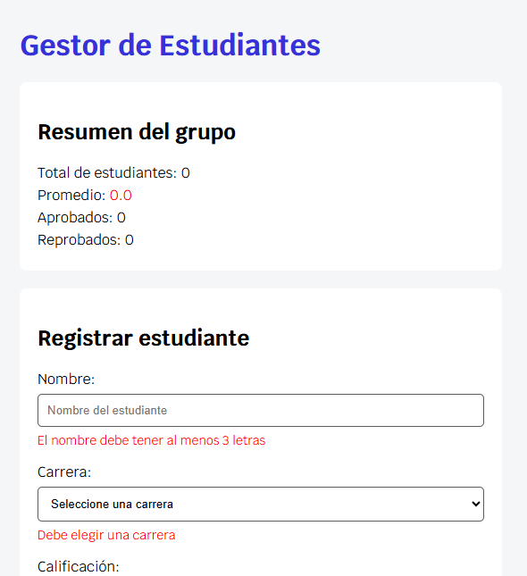
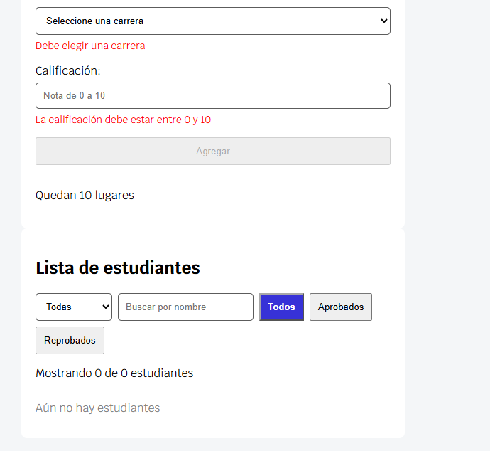

# Gestor de estudiantes

Aplicación web hecha con Vue.js 3 para gestionar los estudiantes de un curso. Trabajo en pareja.

## Cómo ejecutar
Proyecto Vue 3 (Composition API) creado con Vite.

```
npm install
npm run dev
```

## Funcionalidades
- Formulario con validaciones (nombre, carrera y calificación), sin duplicados y con cupo máximo de 10 estudiantes.
- Lista con colores según la nota, estrella con 10, y botones para eliminar, subir (+1) y bajar (−1) la nota.
- Filtros combinados por carrera, nombre y estado (Todos, Aprobados, Reprobados).
- Resumen del grupo: total, promedio, aprobados, reprobados y mejor calificación.
- Mensajes cuando la lista está vacía o no hay coincidencias.
- Botón "Borrar todo".

Los datos se guardan únicamente en memoria: al recargar la página la lista queda vacía.

## Distribución del trabajo
- **Laura Cristina Acevedo Amaya:** formulario con validaciones, lista de estudiantes y botones de nota.
- **Laura Sofía Rueda Cáceres:** filtros, resumen del grupo, mensajes de lista vacía, botón "Borrar todo", estilos y README.

## Capturas de pantalla



## Integrantes
- Laura Cristina Acevedo Amaya
- Laura Sofía Rueda Cáceres